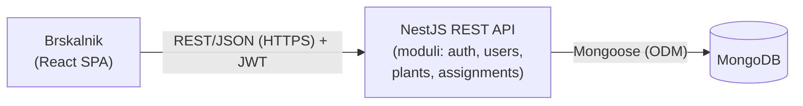

# Arhitektura

## Glavni deli sistema
- Frontend - spletna aplikacija v brskalniku. Prikazuje kartice rastlin, zahteve za varstvo, časovnico dnevnika oskrbe in vlogovno ločene poglede (lastnik / varuh / koordinator).
- Backend (Web API) - REST API, ki nosi vso poslovno logiko: ujemanje, statusni workflow, dodelitev varuha, potrditev vrnitve.
- Podatkovna baza (MongoDB) - hramba uporabnikov, rastlin in varstev z vgnezdenim dnevnikom oskrbe.

## Komunikacija med deli

SPA <-> REST API: REST/JSON prek HTTPS. Vsaka zahteva nosi JWT v Authorization glavi.
API <-> MongoDB: prek Mongoose (ODM za MongoDB v Node/TS).

Komunikacija med SPA in API je sinhroni request/response (REST) - uporabniška dejanja zahtevajo takojšen odziv (potrditev javljenja, dodelitve, vrnitve). 
Znotraj backenda so vse I/O operacije (dostop do baze, pošiljanje e-pošte) asinhrone prek async/await, kar je privzeti neblokirni model Node.js in omogoča sočasno streženje več zahtev.

Sistem je plastni monolit. Koda bo razdeljena na module (npr. users, plants, assignments, auth), vsak modul pa interno na Controller → Service → Repository (Mongoose model). Za obseg projekta so mikrostoritve nepotrebna kompleksnost.

## Podatkovna baza

MongoDB. Varstvo (CareAssignment) ima vgnezden dnevnik oskrbe (CareLogEntry) in razpoložljivost varuha je vgnezdena v User - oboje se bere skupaj, brez dodatnih poizvedb. 

## Avtentikacija in upravljanje uporabnikov

- Registracija in prijava prek NestJS auth modula; gesla hashirana z bcrypt.
- JWT (JSON Web Token) za stateless dostop iz SPA - po prijavi frontend hrani žeton in ga pošilja ob vsaki zahtevi. Izvedba prek Passport.js (@nestjs/passport + passport-jwt).
- Role-based avtorizacija - tri vloge (owner / sitter / admin) se preverjajo prek NestJS Guards (npr. @Roles('admin') + RolesGuard).
- SSO - prijava v spletno aplikacijo s pomočjo SSO

## Način lokalnega zagona

- Docker Compose dvigne celotno okolje z enim ukazom (docker compose up): API, MongoDB.
- .env za konfiguracijo (povezava do baze, JWT skrivnost).

# Diagram

# Tehnološki sklad

| Del | Tehnologija |
|---|---|
| **Frontend** | React + Vite (SPA); Axios za API; React Router |
| **Backend** | NestJS (TypeScript, Node.js) |
| **Podatkovna baza** | MongoDB + Mongoose |
| **Avtentikacija** | JWT prek Passport.js (`@nestjs/passport`, `passport-jwt`), bcrypt za gesla, role-based prek Guards |
| **Lokalni razvoj** | Docker Compose (API + MongoDB), `.env`|
| **Validacija** | `class-validator` |
| **Testiranje** | Jest (privzeto v NestJS) |

# Arhitekturne odločitve (utemeljene)

- NestJS (TypeScript) - ogrodje s strukturo, vgrajeno v samo arhitekturo (moduli, DI, Controller/Service ločitev). TypeScript da tipsko varnost.
- Plastni monolit, modularno - za obseg študentskega projekta so mikrostoritve odveč; NestJS moduli vseeno dajo čisto ločitev domen brez dodatne infrastrukture.
- Ločen SPA + API - čista ločitev frontend/backend, API je neodvisen od prikaza.
- REST - za to domeno povsem zadošča.
- MongoDB (dokumentna baza) - Podatkovni model je deloma relacijski in bi dobro deloval tudi v relacijski bazi, kar bi bila veljavna alternativa. MongoDB sem izbral zaradi (1) fleksibilne sheme za raznolika navodila oskrbe, (2) embeddinga dnevnika v varstvo za branje v enem kosu in (3) single-document atomarne dodelitve varuha (findOneAndUpdate s pogojem na statusu), ki natanko ustreza procesu prevzema varstva.
- SSO - prijava s pomočjo Single-Sign-On
- JWT + role-based prek Passport/Guards - stateless se naravno ujema s SPA; tri vloge se čisto preslikajo v RolesGuard.
- React + Vite - hiter razvojni strežnik; komponentni UI se prilega karticam rastlin in časovnici dnevnika. Skupaj z NestJS je cel sklad v TypeScriptu (en jezik od fronta do backenda).
- Docker Compose za lokalni zagon - reproducibilno okolje z enim ukazom, pokrije zahtevo po načinu lokalnega zagona.