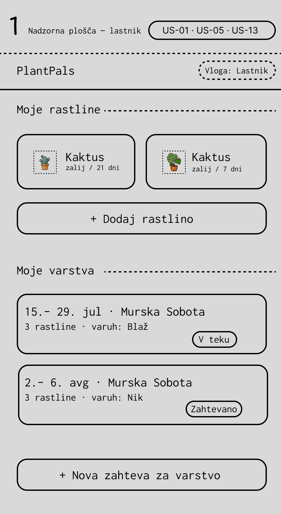
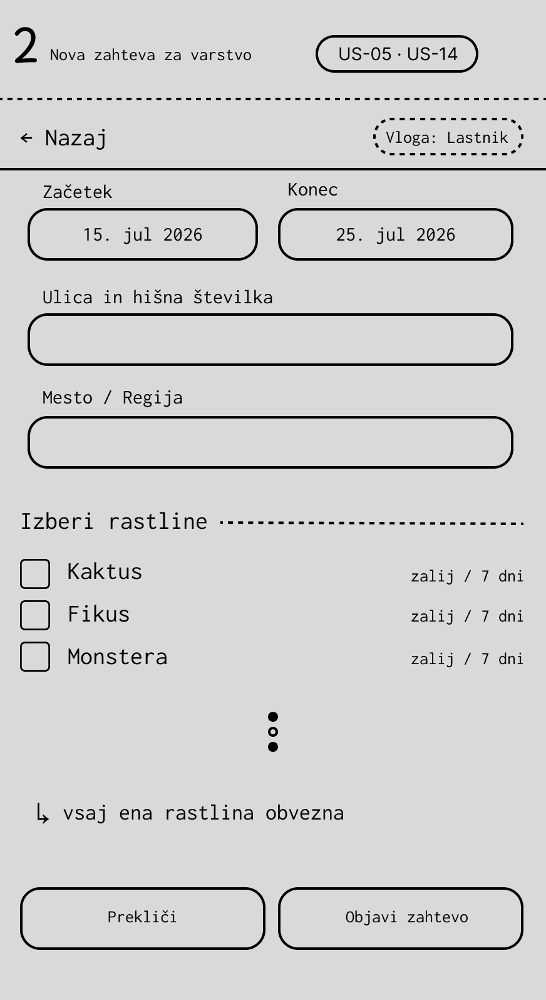
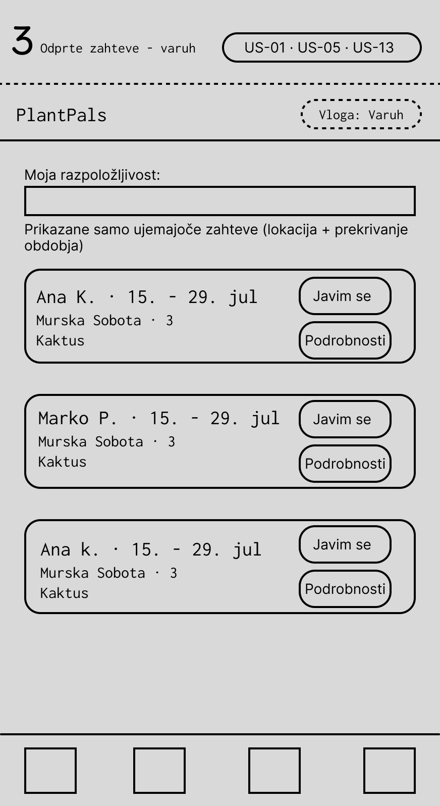

## Wireframe 1 — Nadzorna plošča (lastnik)

Osrednji pogled lastnika. Zgoraj seznam **mojih rastlin** (s pogostostjo zalivanja) z gumbom za dodajanje, spodaj seznam **mojih varstev** s statusnimi značkami (npr. *v teku*, *zahtevano*) in gumbom za novo zahtevo. Značka vloge v glavi ponazarja vlogovno ločen dostop.
**Povezane zgodbe:** US-01 (vodenje rastlin), US-05 (odpiranje zahteve), US-13 (vlogovno ločen dostop).

---

## Wireframe 2 — Nova zahteva za varstvo

Obrazec za odpiranje zahteve: datum začetka in konca, mesto/regija ter izbor rastlin s potrditvenimi polji (vsaj ena obvezna). Pod obrazcem sta gumba *Prekliči* in *Objavi zahtevo*.
**Povezane zgodbe:** US-05 (odpiranje zahteve), US-14 (preklic).

---

## Wireframe 4 — Odprte zahteve (varuh)

Pogled varuha. V glavi je prikazana njegova nastavljena **razpoložljivost** (obdobje + mesto). Spodaj so le zahteve, ki se **ujemajo** po lokaciji in prekrivanju obdobja, vsaka z gumbom *Javim se*. Pri že oddani prijavi je gumb onemogočen (*Prijavljen ✓*), kar prepreči dvojno javljanje.
**Povezane zgodbe:** US-04 (razpoložljivost), US-06 (ujemanje), US-07 (javljanje).
